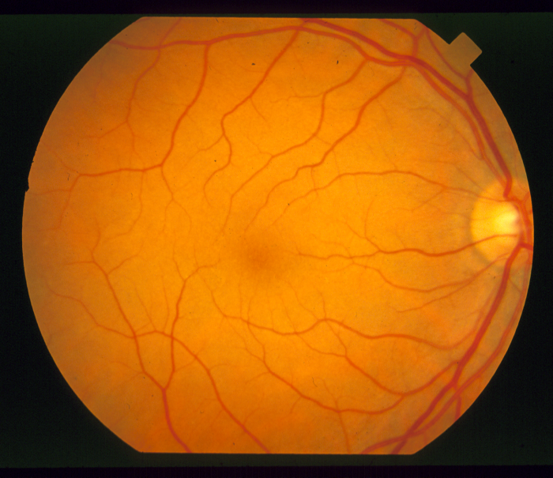
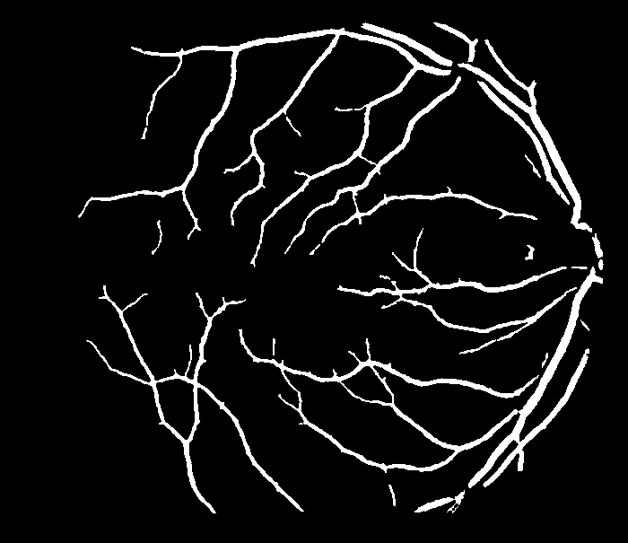
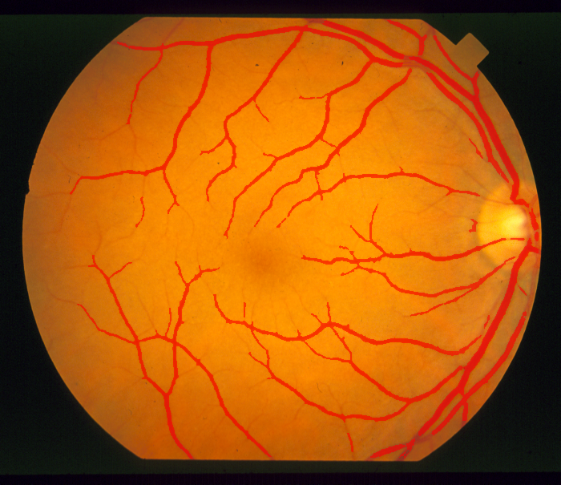

# 眼底血管实时分割硬件加速引擎

在 PYNQ-Z2（Zynq-7020）上，用 Vitis HLS 把眼底血管分割中最耗时的两个算子
（3×3 中值滤波、11×11 黑帽形态学）实现为流式 IP 核，经 AXI DMA 与 PS 端协同。
核心算子单帧 4.476 ms（约 223 fps），相比同一块板上运行 OpenCV 加速 37.6 倍，
且输出与软件参考在 423,500 个像素上逐像素完全一致。

## 核心指标

| 项目 | 数值 |
|---|---|
| 核心算子（中值 + 黑帽） | 168.35 ms → **4.476 ms**，**37.6×**（≈ 223 fps） |
| 端到端 · 不含 FOV 生成 | 284.81 ms → 127.12 ms，**2.24×** |
| 端到端 · 含 FOV 生成 | 397.95 ms → 240.26 ms，**1.66×** |
| 分割精度（评价集，未参与调参） | Dice：STARE **0.7404** / DRIVE **0.7031** |
| 参考基准 | STARE 两位人类专家互比一致性 0.7401（本地实测） |
| 资源（Vivado 实现） | LUT 7497（14.09%）、FF 10269（9.65%）、BRAM 25/140、**DSP 0** |
| 时序 | 100 MHz，WNS **+0.544 ns**，Timing MET |
| 稳定性 | 三轮压测共 **2400 帧**全过，0 挂死 / 0 串帧 / 0 数据错误 |

测试条件与全部数字的出处见 `docs/04_性能评测.md`。

## 效果示例

板端实际运行结果（STARE `im0082`，605 × 700）：

| 原始眼底图 | 血管掩膜（算法输出） | 原图叠加血管 |
|---|---|---|
|  |  |  |

硬件路径与软件路径的掩膜在 423,500 个像素上完全一致（不一致像素 0）。

## 文档

| 文档 | 内容 |
|---|---|
| `docs/01_系统架构.md` | 平台、数据流、Block Design 组成、地址映射、软硬件分工、DMA 约定 |
| `docs/02_算法原理.md` | 算法流程与每步原理、三版迭代对比、精度水平与对标 |
| `docs/03_硬件实现.md` | HLS IP 规格、边界语义、行缓存流式结构、验证结果 |
| `docs/04_性能评测.md` | **唯一数字来源**：三口径定义、逐段耗时、压测、资源与时序 |
| `docs/05_实现历程.md` | 八个阶段的实际完成步骤与关键取舍 |
| `技术文档/` | 完整技术文档（正文 Markdown + 成品 PDF + 参考文献） |

## 目录结构

| 目录 | 内容 |
|---|---|
| `src/` | 算法软件参考实现：`pipeline.py` 主流程、`evaluate.py` 指标、`data_io.py`、`visualize.py` |
| `hls/vessel_prj/` | HLS 源码：`vessel_top.cpp/.hpp`（IP）、`tb_vessel.cpp`（测试台）、`run_hls.tcl` |
| `hls/test_vectors/` | C/RTL 协同仿真比对向量（由 `python工具/gen_test_vectors.py` 生成） |
| `vivado_s10/` | Vivado 集成脚本：`build_bd.tcl` 搭 Block Design、`verify_bd.tcl` 硬检查、综合与实现脚本 |
| `python工具/` | PS 端驱动、演示、压测与指标脚本（12 个，见下） |
| `s11_data_out/` | 板端测试用二进制：605×700 单通道，每帧 423,500 字节 |
| `docs/` | 上述五份文档 |
| `演示素材/` | 板端运行结果图、作品实物照与界面截图（技术文档正文引用的配图） |
| `技术文档/` | 技术文档正文、参考文献、成品 PDF 及其配图 |

### `python工具/` 脚本清单

| 脚本 | 用途 |
|---|---|
| `pynq_vessel_driver.py` | 寄存器级驱动：MMIO 直写 + AXI DMA 传输 |
| `demo_s11_board.py` | 板端一键自包含演示：重载 bit → 重建 MMIO/Buffer → 跑通对比 |
| `demo_ui_board.py` | 板端网页交互界面（端口 7860）：内置图 / 上传图，软件与硬件双跑对比 |
| `fundus_autoloc.py` | 实拍照片自动眼底定位（R−B 色度分割定位视野圆） |
| `regress_im0002_board.py` | 单帧正确性回归（与软件真值逐像素比对） |
| `stress44_selfcontained_board.py` | 连续压测（单图 / 双图交替 / 长时 2000 帧） |
| `make_board_data.py` | 生成板端 `.bin` 测试数据 |
| `gen_test_vectors.py` | 生成 HLS 仿真比对向量 |
| `verify_hls_logic.py` | HLS 逻辑与软件参考的一致性校验 |
| `dump_metrics.py` | 从已有掩膜重算 Dice / Precision / Recall |
| `human_baseline.py` | 计算 STARE 双专家标注之间的一致性（人类基线） |
| `verify_fov_fast.py` | 验证 FOV 闭运算 1 次与 50 次结果一致 |

## 复现路径

1. **算法原型**（PC，Python）：`src/pipeline.py` + `src/evaluate.py`
2. **HLS 实现与仿真**（Linux，Vitis HLS 2022.2）：
   ```bash
   cd hls/vessel_prj
   vitis_hls -f run_hls.tcl          # C 仿真
   vitis_hls -f run_hls.tcl cosim    # C/RTL 协同仿真
   vitis_hls -f run_hls.tcl synth    # 综合并导出 IP
   ```
   `run_hls.tcl -reset` 会清空 `solution1/`，跑之前先备份。
3. **系统集成**（Linux，Vivado 2022.2）：
   `vivado_s10/build_bd.tcl` → `verify_bd.tcl` → `build_synth.tcl` → `build_impl.tcl`
4. **上板验证**（PYNQ-Z2）：`python3 python工具/demo_s11_board.py`

## 关键参数

| 项 | 值 |
|---|---|
| 器件 | `xc7z020clg400-1`（PYNQ-Z2） |
| 血管 IP 控制口 | `0x40000000` |
| AXI DMA 控制口 | `0x41E00000` |
| 图像 | 605 × 700，单帧 423,500 字节，8 bit 灰度 |
| PL 时钟 | 100 MHz |
| 中值窗口 / 黑帽窗口 | 3×3（边界复制）/ 11×11 矩形（膨胀越界填 0、腐蚀越界填 255） |
| DMA 长度位宽 | 26 位（默认 14 位会静默截断，脚本内已强制并加硬检查） |

## 数据集

STARE 与 DRIVE 数据集因体积与版权原因未包含在仓库中，可从官方渠道获取：

- STARE：https://cecas.clemson.edu/~ahoover/stare/
- DRIVE：https://drive.grand-challenge.org/

算法运行结果图也可由仓库内脚本重新生成。

## 环境

- Vitis HLS 2022.2 / Vivado 2022.2（Linux，工程目录不要放在共享文件夹下）
- PYNQ-Z2 + PYNQ v2.7 镜像（板载 OpenCV 4.5.4、numpy）
- PC 侧 Python 3 + numpy + opencv-python（指标评估与可视化）
