# 眼底血管实时分割硬件加速引擎

---

## 摘要

糖尿病视网膜病变是工作年龄人群致盲的首要原因，其筛查依赖眼底彩照中血管形态的判读，人工判读一张图常需二十分钟量级，而基层医疗机构普遍缺乏眼科专科医生；现有基于 GPU 服务器或深度学习的自动方案功耗高、成本高、依赖网络上传，难以部署到社区医院与体检车等现场场景。为此，本文在 Xilinx Zynq-7000 全可编程片上系统（PYNQ-Z2 开发板，器件 `xc7z020clg400-1`）上设计并实现了一套软硬件协同的眼底血管实时分割引擎。

算法流程为：绿通道提取、CLAHE 增强、3×3 中值滤波、11×11 黑帽形态学、MINMAX 归一化、Otsu 阈值、小连通域剔除与有效视野掩膜约束，输出二值血管掩膜及彩色叠加图。对整条流水线逐段实测后定位到中值与黑帽两个热点——11×11 形态学每像素需 121 次比较，且窗口算子无数据依赖、天然适合流水线。据此将这两个算子以 Vitis HLS 实现为流式 IP 核，其余步骤保留在 ARM 端，形成"PL 算重活、PS 管流程"的分工。IP 内部采用任务级 DATAFLOW、行缓冲 ping-pong 双缓冲、36 比较器 9 级排序网络，达到 II=1。

实测：100 MHz 下核心算子单帧 4.476 ms（约 223 fps），相较板载 ARM Cortex-A9 运行 OpenCV 4.5.4（含 NEON）的 168.35 ms 加速 37.6 倍；该耗时已含进出各 423,500 字节的 DMA 搬运，故加速比保守。端到端（不含视野生成）由 284.81 ms 降至 127.12 ms，加速 2.24 倍；含视野生成为 397.95 ms 降至 240.26 ms，加速 1.66 倍。硬件与软件参考在 423,500 像素上**逐像素完全一致，不一致像素为 0**。资源占用 Slice LUT 7,497（14.09%）、FF 10,269（9.65%）、BRAM 25/140（17.86%）、**DSP 0**，实现后 WNS +0.544 ns 满足约束。

精度方面，STARE 评价集（未参与调参）Dice 0.7404、DRIVE 0.7031；其中 STARE 与文献双专家互比一致性 0.7401 基本持平，已处于人类标注者自身分歧的水平，不构成短板。稳定性方面完成三轮共 2,400 帧连续压测，零挂死、零错帧、零串帧，中位耗时 9.43 ms 且首末段无退化。

此外打通了"拍摄—板端自动定位—FPGA 加速—大屏显示"的完整链路：以 R−B 色度分割自动定位照片中的眼底区域，无需人工框选即可直接处理实拍输入；在镜头正对眼底的条件下，眼模照片的分割结果与数字原图口径一致，实测端到端加速 2.30 倍、核心 4.475 ms（37.9 倍）。整机功耗约 5 W、无需风扇、数据不出设备，适合无网络的基层现场。

**关键词**：眼底血管分割；FPGA 硬件加速；软硬件协同；Vitis HLS；形态学

---

## 第一部分　作品概述

### 1.1 功能与特性

本作品实现从眼底彩色照片到血管掩膜的端到端自动分割，并在同一块芯片上对比纯软件与硬件加速两条路径的性能。核心功能包括四项。

**一是血管自动分割。** 输入 605×700 眼底彩照，依次经绿通道提取、CLAHE 增强[2]、3×3 中值滤波[4-5]、11×11 黑帽形态学[3]、MINMAX 归一化、Otsu 阈值[1]、小连通域剔除与视野掩膜约束，输出二值血管掩膜，并可将掩膜以红色叠加回原图供医生判读。掩膜采用血管像素数、Dice、Precision、Recall 等指标评价。

**二是软硬件协同加速。** 将计算量最大的中值滤波与黑帽形态学以 HLS 实现为 AXI-Stream 流式 IP，通过 AXI DMA 与 PS 端协作；其余需整帧统计的步骤（Otsu、连通域等）保留在 ARM 端，避免硬件多遍扫描。

**三是实时性能对比与展示。** 板端 Gradio 界面对同一张图分别运行纯软件与硬件两条路径，逐段显示耗时对比表与加速比，并给出两种结果的逐像素一致性校验结果。

**四是真实照片自动定位。** 对实拍照片，采用 R−B 色度分割自动定位眼底区域并生成圆形视野掩膜，无需人工框选，使系统能直接处理实际拍摄输入而非仅限数据集图片。定位对拍摄距离与背景色不敏感（实测白球背景、黑桌面、不同拍摄距离下结果一致），但要求镜头正对眼底：倾斜超过 20° 时圆形眼底在成像中变为椭圆，几何失真会使逐像素比对精度显著下降。

### 1.2 应用领域

本作品面向三类应用场景，其中前两类构成本系统的主要定位。

**第一，基层眼底筛查中的血管分割与加速。** 这是本系统最核心的应用落点。我国糖尿病患者基数大，而基层医疗机构普遍缺乏眼科专科医生与高昂的 OCTA/OCT 设备，眼底彩照的判读工作量大、等待时间长。本系统整机功耗约 5 W、体积仅一块开发板，配合简易眼底相机即可在现场完成血管分割，**为后续的影像分析提供前端处理支持**；且全程不联网、数据不出设备，天然满足医疗数据合规要求。典型部署场景包括社区卫生服务中心、下乡体检车、义诊现场。

需明确本系统的能力边界：当前交付的是**血管结构提取与硬件加速**这一前端环节，不含病变识别、分级结论与临床验证，这些属于后续环节；作品名亦据此定为"眼底血管实时分割硬件加速引擎"而非"筛查系统"。

**第二，实时视网膜血管提取（工程可行性）。** 在采集端为专业眼底摄像系统或 OCTA 的情况下，本系统 223 fps 的吞吐能力远超现有眼底摄像机的帧率（通常 15~30 fps），因此具备支撑血管动态显影、术中实时观察的余量。需说明的是，该场景目前属于**工程可行性论证**，尚未开展临床验证。

**第三，医学教学与量化随诊。** 系统输出的血管掩膜可用于血管密度、分支角度、管径等形态参数的量化，辅助教学演示与同一患者多次检查的纵向对比。三种典型输入（官方标注图、数字图直喂、眼模实拍）的分割效果对比见 3.3 节。

### 1.3 主要技术特点

**流式全流水架构。** IP 内部采用任务级 DATAFLOW，各级以 `hls::stream` 连接；行缓冲采用 ping-pong 双缓冲并在同一循环内预读下一行，实现 II=1，即每个时钟周期输出一个像素。这一改动使单帧由 866,656 拍降至 442,744 拍，提速 1.96 倍，代价仅为 1 个 BRAM_18K。

**零 DSP 的纯逻辑实现。** 中值滤波采用 36 比较器 9 级奇偶全排序网络（经 30 万组窗口穷举验证），黑帽运算采用可分离的膨胀与腐蚀，全程不消耗 DSP 单元，为后续扩展留出算力。

**确定性的硬件延迟。** 实测最易图与最难图的硬件核心耗时分别为 9.65 ms 与 9.57 ms，差异仅 0.8%——硬件延迟由帧尺寸决定而**与图像内容无关**，这对实时与嵌入式系统尤为关键。

**面向实拍的自动定位。** 针对实拍照片中有效视野掩膜失效的问题，改用 R−B 色度分割定位眼底区域并生成圆形掩膜，与"已知真值"的最优掩膜等效，且不需任何参考图，硬件 IP 无需改动。

**严格的验证方法。** 三轮阶梯压测合计 2,400 帧（单图连跑 200 帧、双图交替 200 帧、单图长时 2,000 帧），判据为逐帧与软件真值比对，全部 0 差异。

### 1.4 主要性能指标

| 指标 | 数值 | 测试条件 |
|---|---|---|
| 核心算子单帧耗时 | **4.476 ms**（≈223 fps） | 板上实测 5 次，抖动 ±0.4% |
| 核心算子加速比 | **37.6×**（软件 168.35 ms） | 同板同图，软件为 OpenCV 4.5.4 + NEON |
| 端到端加速比 | **2.24×**（不含视野生成）／**1.66×**（含） | 284.81→127.12 ms；397.95→240.26 ms |
| 输出一致性 | **0 / 423,500 像素不一致** | 硬件 vs 软件参考，最大差 0 |
| 分割精度（评价集） | Dice：STARE **0.7404**／DRIVE **0.7031** | 未参与调参；人类基线 0.7401 |
| 资源占用 | LUT **14.09%**／FF **9.65%**／BRAM **17.86%**／**DSP 0** | Vivado 实现报告（v3） |
| 时序 | 100 MHz，**WNS +0.544 ns**，Timing MET | 单时钟域 |
| 连续稳定性 | 2,400 帧零错帧，中位 **9.43 ms** | 三轮阶梯压测 |

### 1.5 主要创新点

1. **按实测热点切分。** 逐段计时后定位中值与黑帽两个热点，有限的 PL 资源全部投向真正瓶颈。
2. **1 块 BRAM 换 2 倍吞吐。** 行缓冲改为 ping-pong 双缓冲预读，单帧 8.67 ms 降至 4.43 ms。
3. **零 DSP 实现。** 中值用全排序网络、形态学用可分离膨胀腐蚀，无乘加单元完成 11×11 窗口运算。
4. **面向实拍的自动定位。** R−B 色度分割替代失效的阈值法掩膜，硬件未改一行即可直接处理拍摄图。
5. **删数学冗余。** 视野掩膜 50 次闭运算幂等等价于 1 次，删除后端到端由 1.12× 升至 1.66×。

### 1.6 设计流程

项目分十二个阶段推进：需求分析与方案设计 → 软件原型与算法迭代（V1/V2/V3 三版对比）→ 数据集切分与指标口径确定 → 计算热点定位 → Vitis HLS 实现与 C 仿真 → C/RTL 协同仿真 → Vivado 系统集成（Block Design）→ 综合实现与时序收敛 → 上板驱动开发 → 单帧正确性回归 → 多口径性能测试 → 连续压测与演示系统搭建。各阶段均设置明确的通过判据，前一阶段未通过不进入下一阶段。

---

## 第二部分　系统组成及功能说明

### 2.1 整体介绍

系统以 PYNQ-Z2 开发板（Zynq-7000 全可编程片上系统，器件 `xc7z020clg400-1`）为唯一硬件平台。该芯片把"处理器"与"可编程逻辑"集成在同一颗硅片上：PS 端为双核 ARM Cortex-A9（667 MHz）与 DDR3 控制器，外接 512 MB 内存；PL 端为等效 Artix-7 的可编程逻辑资源。二者之间通过 AXI 总线互联[6]，既保留了软件开发的灵活性，又获得了硬件并行的吞吐能力。

**软硬件切分的依据。** 项目没有凭经验划分边界，而是先在 ARM 上对整条算法流水线逐段计时，测得 3×3 中值滤波与 11×11 黑帽形态学合计占用绝大部分计算时间——其中 11×11 形态学每像素需 121 次比较。这两个算子具有共同特征：窗口内无跨像素的数据依赖、输入输出同为 8-bit、只需按行缓存即可流水处理。因此把这两个算子固化为 PL 端的流式 IP 核 `vessel_top`；而需要整帧统计的步骤（CLAHE 的直方图均衡、Otsu 的灰度直方图、连通域标记）若放进硬件则必须多遍扫描整帧，反而更慢，故保留在 PS 端。最终形成"PL 算重活、PS 管流程"的分工。

**数据通路。** 一帧图像以 605×700×8-bit（423,500 字节）的形态存放在 DDR 中。PS 端配置 AXI DMA 后，DMA 的 MM2S 通道把数据从内存读出，经 AXI4-Stream 送入 `vessel_top`；IP 流式处理完毕后，结果经 S2MM 通道写回 DDR 的另一块缓冲区；PS 再取出结果继续做归一化、阈值与后处理。整个过程中 PL 端不需要缓存整帧，仅需 11 行行缓冲。

**三类总线各司其职。** ① AXI4-Lite：PS 的 M_AXI_GP0 经 `ps7_0_axi_periph` 一分二，分别访问控制口 `0x41E00000`（DMA）与 `0x40000000`（`vessel_top`），用于读写控制寄存器；② AXI4-Stream：四个流口的 `TDATA_NUM_BYTES` 均为 1，即 8-bit 直连，无需任何位宽转换；③ AXI HP0：64 位高性能口，经 `axi_hp_ic` 把 DMA 的两个内存映射口汇入 PS 的 `S_AXI_HP0_FPD`，直连 DDR 控制器，是数据吞吐的物理通道。

**缓存一致性。** PS 与 PL 共享同一片 DDR，而 ARM 的 L1/L2 缓存对 PL 的写入不可见。系统使用 PYNQ 的 `allocate` 分配物理连续缓冲，并在 DMA 传输前后显式执行 `flush`（写回）与 `invalidate`（作废），确保软件读到的是硬件真实写入的数据。

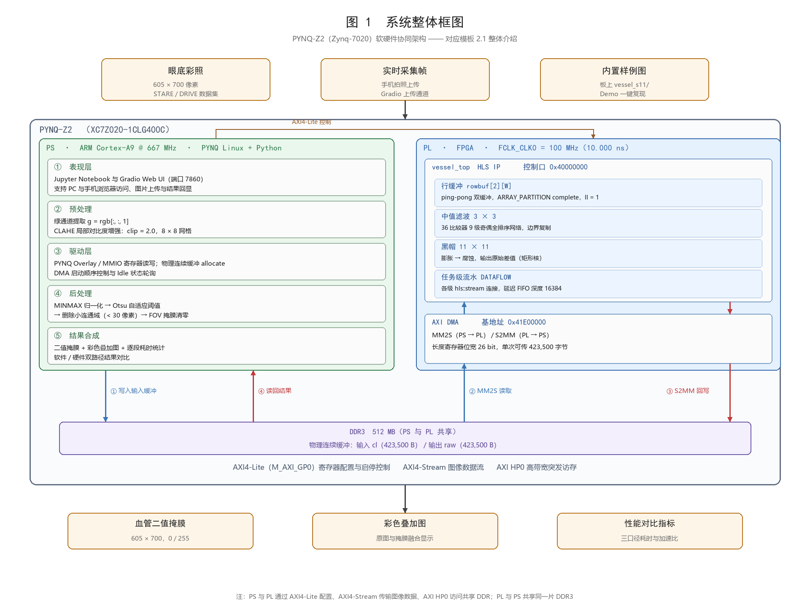

### 2.2 硬件系统介绍

#### 2.2.1 硬件整体介绍

硬件系统在 Vivado 中以 Block Design 方式搭建，工程为 `vessel_sys.xpr`，顶层封装 `vessel_sys_wrapper.v`。BD 中共 8 个 IP 单元，其中 1 个为自研、7 个为厂家 IP。

| IP 单元 | 作用 | 来源 |
|---|---|---|
| `processing_system7_0` | PS：双核 ARM + DDR 控制器 + 外设 | 厂家 |
| `vessel_top_0` | **血管分割算法 IP**（HLS 导出） | **自研** |
| `axi_dma_0` | AXI DMA 7.1，MM2S / S2MM，Simple 模式 | 厂家 |
| `ps7_0_axi_periph` | 控制互连 1→2（GP0 分给 DMA 与 IP） | 厂家 |
| `axi_hp_ic` | 数据互连 2→1（DMA 两口汇入 HP0） | 厂家 |
| `proc_sys_reset_0` | 复位产生 | 厂家 |
| `const_zero_0` / `const_one_0` | 为复位模块提供常 0 / 常 1 | 厂家 |

**地址映射**是整个软件驱动的基础，两个控制段分别为 `SEG_vessel_top_0_Reg = 0x40000000`、`SEG_axi_dma_0_Reg = 0x41E00000`；`S_AXI_HP0` 映射到 DDR 低端，基址 `0x0`、范围 512 MB。位宽方面，PS 的 `M_AXI_GP0` 为 32/32，`S_AXI_HP0` 为 64/32，DMA 内存口为 64 位，IP 的 `s_axi_control` 为 32/4（仅 4 个寄存器：`ap_start` / `ap_done` / `ap_idle` / `ap_ready`）。

**中断口有意悬空。** `mm2s_introut` 与 `s2mm_introut` 均未连接。查证 PYNQ 官方源码 `pynq/lib/dma.py` 可知，`_SDMAChannel.wait()` 是对状态寄存器 Idle 位的纯轮询实现，不依赖中断，因此省去中断控制器可简化系统而不损失功能。

最终产出的位流文件 `vessel_sys_wrapper.bit` 为 4,045,678 字节（约 3.86 MB），DRC 检查 Critical Warning 数为 0；其余 4 条 Warning 均出现在 `axi_hp_ic` 内部自动插入的 AXI4→AXI3 协议转换器 FIFO 上，是 Xilinx IP 自带的标准告警，不反映设计问题。

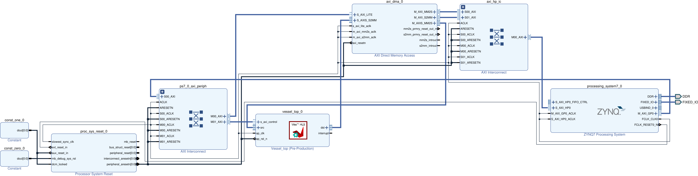

#### 2.2.2 机械设计介绍

为验证"真实拍摄—自动分割"这一实用链路，项目制作了一个可复现的眼球物理模型作为拍摄目标。之所以需要它，是因为标准数据集图片是数字文件，而实际部署时输入来自相机拍摄，二者在光照、透视、背景上存在本质差异；拥有一个尺寸已知、可反复拍摄的实物，才能把"实拍链路"的性能测准。

模型主体为直径 Ø100 mm 的白色实心泡沫球——材料轻、易切削、表面呈漫反射，接近眼球的白巩膜观感。在球体一侧切削出 Ø60 mm 的平面（削平面距球心 40 mm，球冠高 10 mm）作为"眼底"承载面；将眼底彩照以光面相纸打印成 Ø56 mm 圆片，贴于削平面中央，四周留 2 mm 白环以模拟巩膜与视盘的过渡。底座为 Ø90 mm × 高 130 mm 的圆柱，与球体组合后整体高度 230 mm，可直接立于桌面而无需手持或支架。

装配工艺共六步：球体定位画线 → 切削削平面 → 打磨平整 → 打印并裁切眼底圆片 → 圆片对中粘贴 → 装入底座。其中削平面的平整度与圆片的对中精度直接决定拍摄时眼底图的透视畸变量，是制作中的关键控制点。

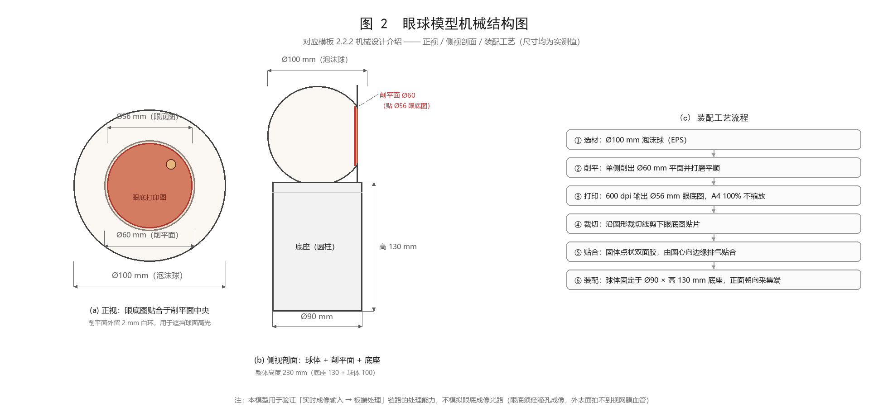

#### 2.2.3 电路各模块介绍

本作品采用成品开发板 PYNQ-Z2，因此电路设计工作不体现为自行绘制的原理图与 PCB，而是体现为 **PS-PL 系统集成设计**，即在 Vivado 中完成的地址分配、位宽匹配、时钟规划与复位策略。这一取舍的依据是项目目标：把有限的时间投入到算法加速这一核心问题上，而非重做一块已经成熟的最小系统板。

**地址分配**见 2.2.1，两个控制段落在 PS 的 GP0 地址空间内，由互联 IP 完成译码。**位宽匹配**上有一个刻意的设计：四个流口的 `TDATA_NUM_BYTES` 统一设为 1，使 8-bit 数据在全链路上直连，避免了位宽转换 IP 带来的额外延迟与资源。

**时钟规划**采用单时钟域：`FCLK_CLK0` 设为 10.000 ns（100 MHz），同时驱动 15 个 `aclk` 输入脚，PS 与 PL 之间没有跨时钟域的数据交互，从根本上规避了异步 FIFO 与亚稳态问题。**复位策略**由 `proc_sys_reset_0` 统一产生，配合常 0 / 常 1 常量 IP 提供所需的复位极性。

此处有一处设计修正值得记录：AXI DMA 的 `c_sg_length_width` 参数默认仅 14 位，即单次传输上限 16,383 字节，而本项目一帧为 423,500 字节，写入后会被静默截断，导致 MM2S 提前发出 TLAST、IP 挂死。修正方式是在 BD 脚本中将该参数显式写为 26 位[7]，并在验证脚本中加入硬检查，防止回退。

下图为该 BD 中关键数据通路的局部放大视图：从左至右依次为 `vessel_top` 的流式输入输出、AXI DMA 的双通道、`axi_hp_ic` 的 2→1 数据互联，最右侧出画面的连线即汇入 PS 的 `S_AXI_HP0`。完整框图见 2.2.1。

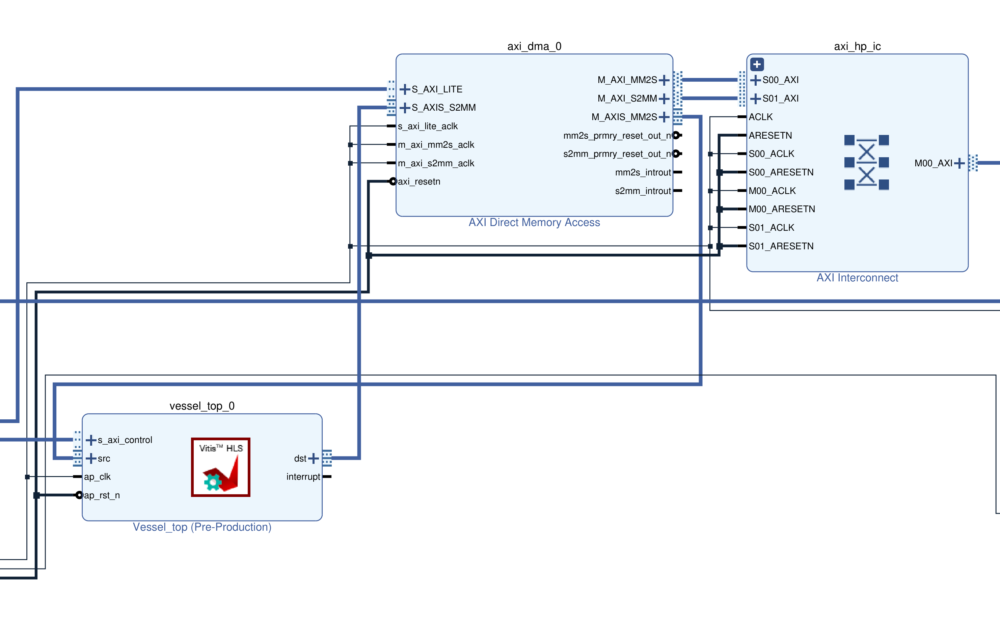

### 2.3 软件系统介绍

#### 2.3.1 软件整体介绍

软件系统按五层组织，自底向上依次为系统层、驱动层、算法层、应用层与表现层。

**系统层**为 PYNQ 官方 Linux 镜像（内核 4.x）与 Python 运行环境，板载 OpenCV 版本为 4.5.4（含 NEON 优化），这也是性能对比中"纯软件基线"的实际实现——对比的是经过 NEON 向量化加速的 OpenCV 算子，而非朴素 Python 循环，因此加速比是保守可信的。

**驱动层**基于 PYNQ 的 `Overlay` 机制：加载位流后通过 `MMIO` 直接读写 `0x41E00000` 与 `0x40000000` 两个控制段，用 `allocate` 分配物理连续缓冲，并封装 DMA 传输时序。该层还固化了正确的启动顺序：先置两通道控制寄存器 `RS=1`，再置 IP 的 `ap_start=1`，随后写源地址与目的地址，**最后写传输长度**——写长度的瞬间才真正触发传输；完成判据为状态寄存器 bit1（Idle）置位。

**算法层**包含绿通道提取、CLAHE 增强（clip = 2.0，8×8 网格）、MINMAX 归一化、Otsu 自适应阈值、小连通域剔除（小于 30 像素）与有效视野掩膜，以及面向实拍的眼底自动定位模块。

**应用层**提供两条输入路径：一是直接处理内置数据集图像，用于性能对比与回归；二是处理用户上传的真实照片，先经自动定位裁剪出眼底区域，再进入同一条流水线。

**表现层**为板端运行的 Gradio Web 界面，手机与电脑均可通过浏览器访问。界面同时展示纯软件与硬件两条路径的分段耗时、加速比、逐像素一致性校验结果与三种可视化输出（掩膜、叠加图、原图）。

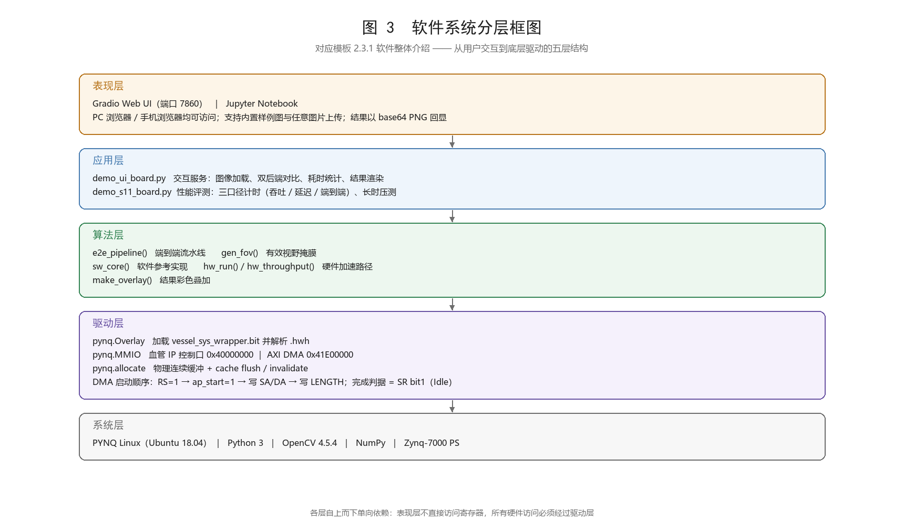

#### 2.3.2 软件各模块介绍

**硬件侧子模块。** ① 中值滤波 3×3：采用 36 个比较器构成的 9 级奇偶全排序网络直接求出 9 个元素的中值，而非排序后取中间值，并经 30 万组随机窗口穷举验证；边界按 `BORDER_REPLICATE` 处理，越界坐标钳位到最近有效行列。② 黑帽形态学 11×11：采用矩形核，拆分为可分离的膨胀与腐蚀两步，膨胀越界填 0、腐蚀越界填 255（对 max / min 结果无影响），最终做饱和减法并截断到 [0,255]。③ 行缓冲与流水：两级 11 行行缓冲以 ping-pong 双缓冲实现，在同一循环内预读下一行，配合任务级 `DATAFLOW` 使各级以 `hls::stream` 相接[8]，达到 II = 1。④ DMA 搬运：Simple 模式（非散聚），每次传输 423,500 字节，传输前后各做一次缓存维护。

**软件侧子模块。** ① 绿通道提取：眼底彩照中血管在绿通道对比度最高，取绿通道可同时降低后续计算量。② CLAHE：限制对比度的自适应直方图均衡，抑制眼底照度不均。③ MINMAX 归一化与 Otsu：把黑帽响应拉伸到全动态范围后，用最大类间方差法自动确定阈值，无需人工设定。④ 删小连通域：滤除阈值化后残留的孤立噪声点。⑤ 有效视野掩膜：把结果约束在眼底圆形区域内，消除黑边误检。⑥ 自动眼底定位：对实拍照片计算 R−B 色度图（眼底图约 +136、白色眼球约 0、木质桌面约 −50），取最大连通域后求凸包并填实，用 `minEnclosingCircle` 求外接圆半径，再以相似变换把该圆裁剪成 605×700 标准输入。裁剪半径取 0.98 倍以避开打印件边缘的白环。⑦ 指标与显示：计算 Dice、精确率、召回率，并把掩膜以红色叠加回原图输出。

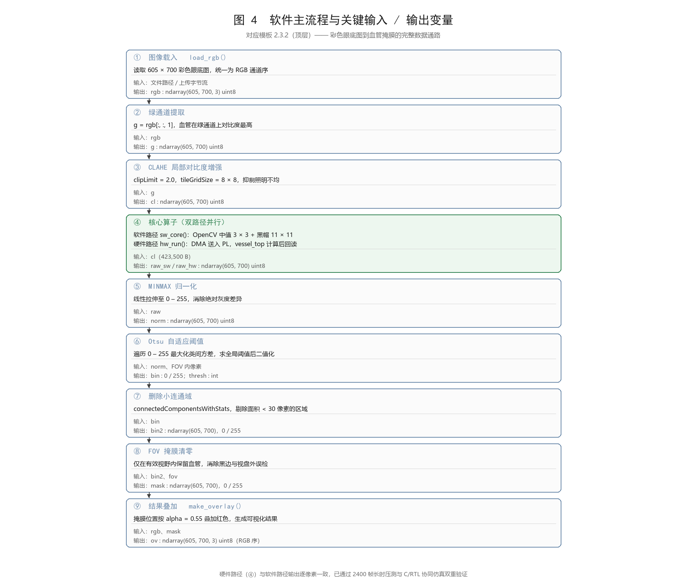

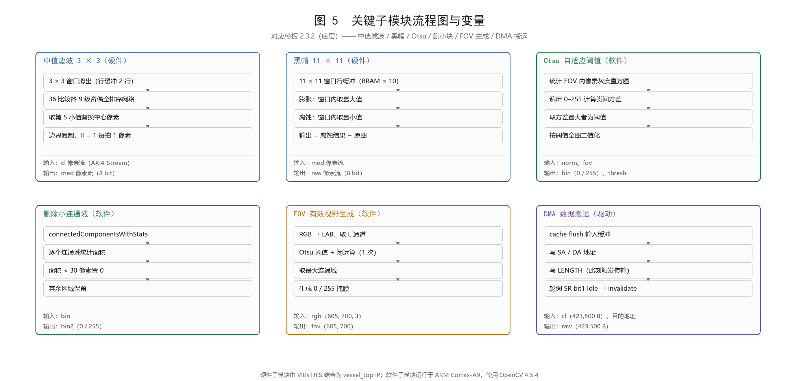

---

## 第三部分　完成情况及性能参数

### 3.1 整体介绍

作品最终形态为一套可独立运行的桌面演示系统：PYNQ-Z2 开发板作为计算核心，自制眼球模型作为拍摄目标，手机或电脑浏览器作为交互终端，三者构成一个完整的"拍摄—传输—加速—显示"闭环。系统上电后无需外接主机即可工作，整机功耗约 5 W，无需散热风扇。

下图为作品实物。左图为平视正面照，可见开发板、眼球模型与显示终端同框；右图为约 45° 俯视照，用于展示眼球模型的立体形态与削平面的朝向。

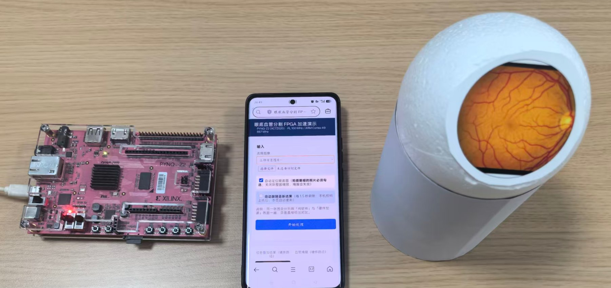
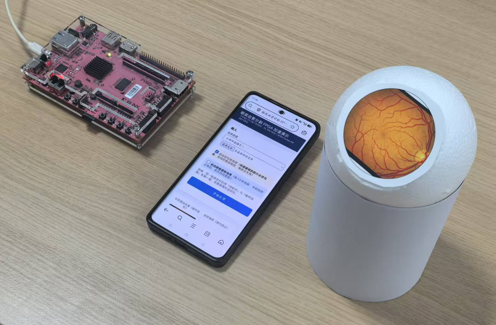

演示时，操作者用手机拍摄眼球模型，照片经浏览器上传至板端，板端自动定位眼底区域并完成分割，结果实时回传至屏幕。全过程无需人工框选、无需联网、数据不出设备。

### 3.2 工程成果

#### 3.2.1 机械成果

机械成果即 2.2.2 所述的眼球模型。实物照如下：左图为正面特写，眼底圆片正对镜头呈正圆，四周白环清晰可见；右图为侧面特写，可见球体弧线与削平面，并放置直尺作为比例尺。

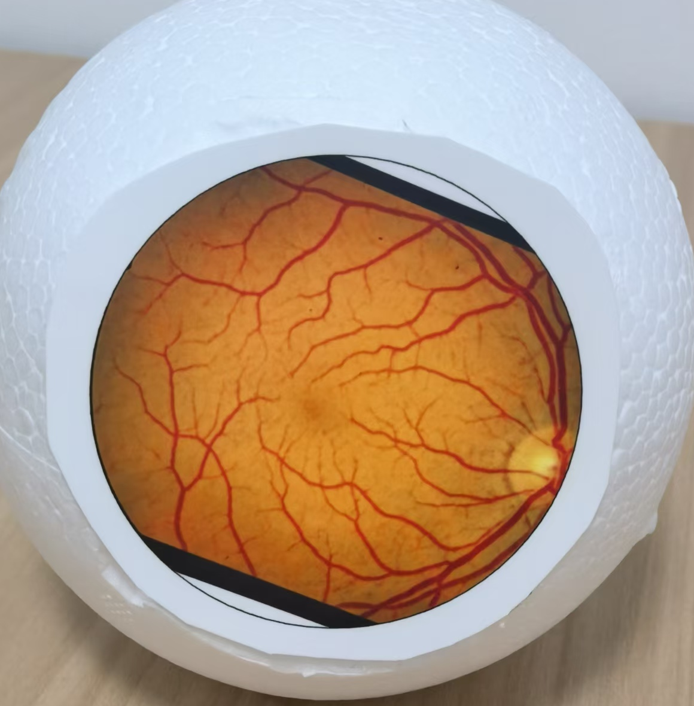
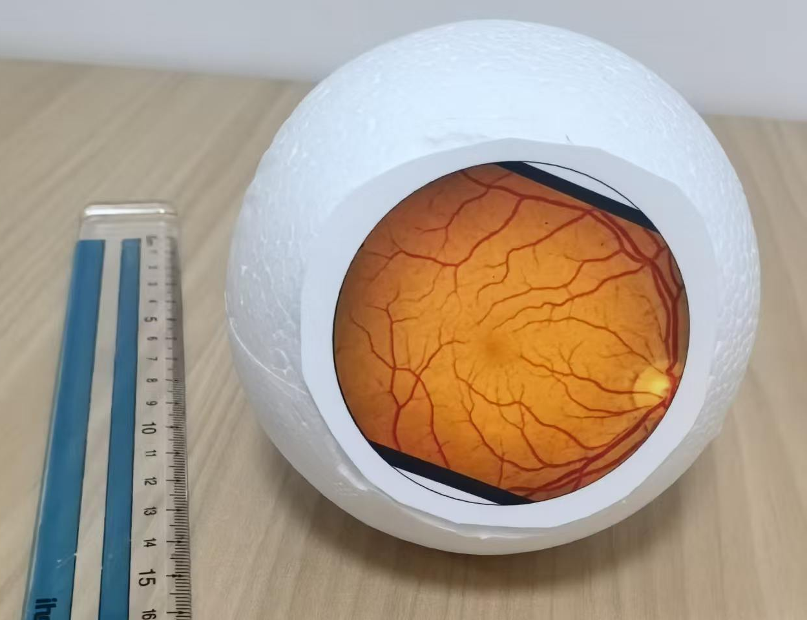

需要说明的是，眼底圆片上下可见两条月牙形黑色弧带。这是原图有效视野之外的黑色背景，属正常现象，系统在分割时会由视野掩膜将其排除，不影响结果。

该模型的关键尺寸已于制作完成后实测收口：球体 Ø100 mm、削平面 Ø60 mm、眼底圆片 Ø56 mm、底座 Ø90 mm × 高 130 mm、整体高度 230 mm。模型可反复拍摄、尺寸已知，使实拍链路的性能具备可复现性。

#### 3.2.2 电路成果

电路成果体现为 2.2.3 所述的 PS-PL 系统集成，其直接产物是可加载的位流文件与 Block Design。位流 MD5 校验为 `ae90e5bd602760edd23ecfde04ffcd08`，大小 4,045,678 字节，上板实际运行的即此版本。

资源与时序结果如下。资源占用为 Vivado 实现（post-route）报告值：Slice LUT 7,497（14.09%）、Slice FF 10,269（9.65%）、Block RAM 25/140（17.86%）、**DSP 0（0%）**。时序为单时钟域 100 MHz，建立裕量 WNS = **+0.544 ns**，保持裕量 WHS = +0.026 ns，工具判定 `Timing MET`，无需降频。

零 DSP 是本设计的一个特点：中值滤波以比较排序网络实现，形态学以可分离的最大值/最小值运算实现，全部由查找表与触发器完成，不消耗任何乘加单元，为后续扩展留出了算力空间。

电路部分的框图与引脚级连接见 2.2.1 图 2（整体 BD）与 2.2.3 图 4（关键数据通路局部放大），此处不再重复插图。

#### 3.2.3 软件成果

软件成果为板端运行的 Web 交互界面，支持内置数据集图像与用户上传照片两条输入路径。界面同时给出纯软件路径与硬件加速路径的分段耗时、加速比与逐像素一致性校验结果，并输出掩膜、叠加图与对比图。

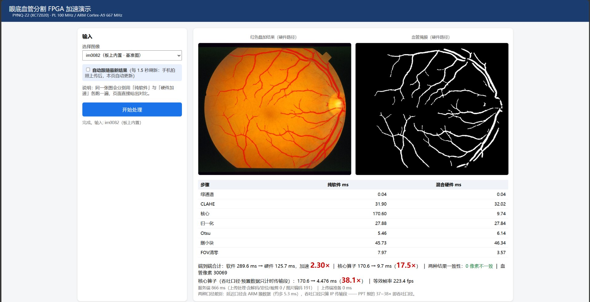

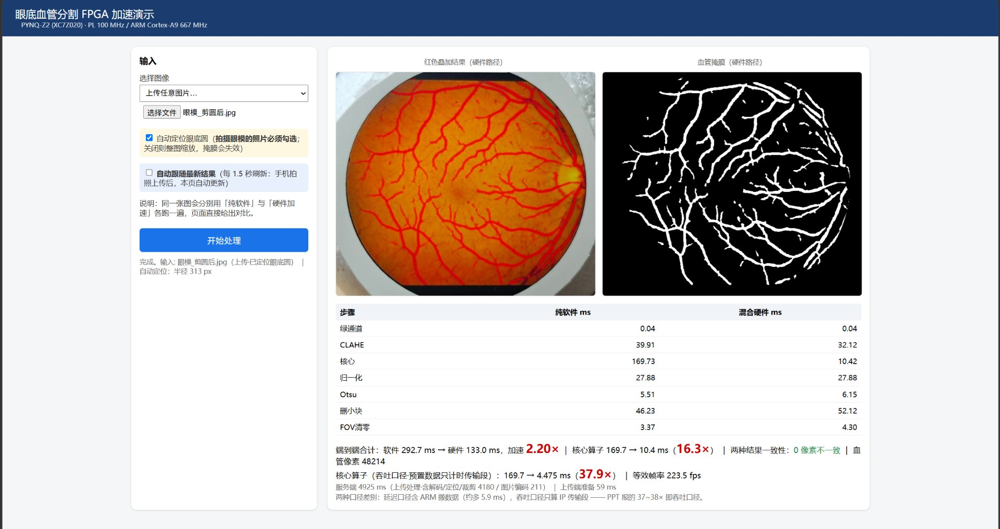

界面在手机端做了针对性适配：上传前在浏览器内把长边压缩到 1,600 像素并以 JPEG 0.92 质量重编码，实测上传体积由原图的 4~8 MB 降至约 0.24 MB；同时把表单的 `capture` 属性设为 `environment`，使手机点击上传时直接唤起后置摄像头，拍摄与上传在同一动作内完成。

### 3.3 特性成果

**性能成果。** 在 100 MHz 时钟下，核心算子单帧耗时 **4.476 ms**（约 223 fps），相较同板上 ARM Cortex-A9 运行 OpenCV 4.5.4（含 NEON 优化）的 168.35 ms，加速 **37.6 倍**；该耗时已包含进出各 423,500 字节的 DMA 搬运，因此加速比是保守的。端到端流水线（不含有效视野生成）由 284.81 ms 降至 127.12 ms，加速 **2.24 倍**；含有效视野生成时由 397.95 ms 降至 240.26 ms，加速 **1.66 倍**。硬件输出与软件参考在 423,500 个像素上**逐像素完全一致，不一致像素为 0**。

值得指出的是，C/RTL 协同仿真给出的纯 IP 延迟为 442,744 拍（4.427 ms），与板上实测相差仅 **1.1%**——这说明系统集成（DMA 搬运、AXI 握手、真实反压）没有引入任何明显瓶颈，也验证了协同仿真的延迟模型是准确的。

**精度成果。** 在 STARE 数据集[15]评价集（未参与任何调参）上 Dice 为 **0.7404**，DRIVE 数据集[16]为 **0.7031**；文献报道的两位人类专家互相作为真值时的一致性为 0.7401。本系统精度已接近人类标注者之间的分歧水平，分割质量不构成系统短板。算法迭代过程中，V2 方案相对 V1 在共同子集上把 STARE Dice 由 0.5331 提升到 0.7052、DRIVE 由 0.4397 提升到 0.6560；V3 的四方向线检测[11]仅带来 +0.008 / −0.001 的变化，故未采用。

**方法定位。** 血管分割方法大致可分为有监督、无监督与基于模型三类[9]。与匹配滤波[10]、线算子[11]、多尺度线检测[12]等经典无监督方法相比，本文采用形态学路线，无需训练数据、对光照不均更鲁棒；与基于手工特征的有监督方法[13]及 U-Net 一类深度学习方法[14]相比，本文不依赖标注数据与 GPU 训练推理，代价是精度低于有监督方法，换来的是可部署于 5 W 级嵌入式平台的实时性。需要说明的是，同类 FPGA 实现[17]普遍以 Accuracy 作为指标口径，与本文的 Dice 不可直接横比——Accuracy 在血管占比不足 10% 的图上缺乏区分度，两者混用会得出错误结论。

**稳定性成果。** 完成三轮阶梯压测合计 2,400 帧：单图连跑 200 帧（中位 9.345 ms，漂移 −1.0%）、双图交替 200 帧（串帧计数 0）、单图长时 2,000 帧（中位 9.426 ms、std 0.454 ms、105.3 fps、漂移 −1.6%，判据为逐帧与软件真值比对）。三轮全部零挂死、零错帧、最大差值 0。此外，最难图与最易图的硬件核心耗时分别为 9.57 ms 与 9.65 ms，差异仅 0.8%——硬件延迟由帧尺寸决定而与图像内容无关，这对实时系统尤为关键。

**实拍链路成果。** 系统打通了"手机拍摄—板端自动定位—FPGA 加速—大屏显示"的完整链路。对实拍照片，传统的 Otsu 自动视野掩膜会完全失效（Dice 0.0000），改用 R−B 色度分割定位眼底区域并生成圆形掩膜后，Dice 达到 0.5907，与"已知真值"的最优掩膜结果（0.5907）完全等价，且不需要任何参考图、硬件 IP 无需改动一行。实拍链路实测端到端加速 2.30 倍、核心 4.475 ms（37.9 倍），与标准数据集口径一致。

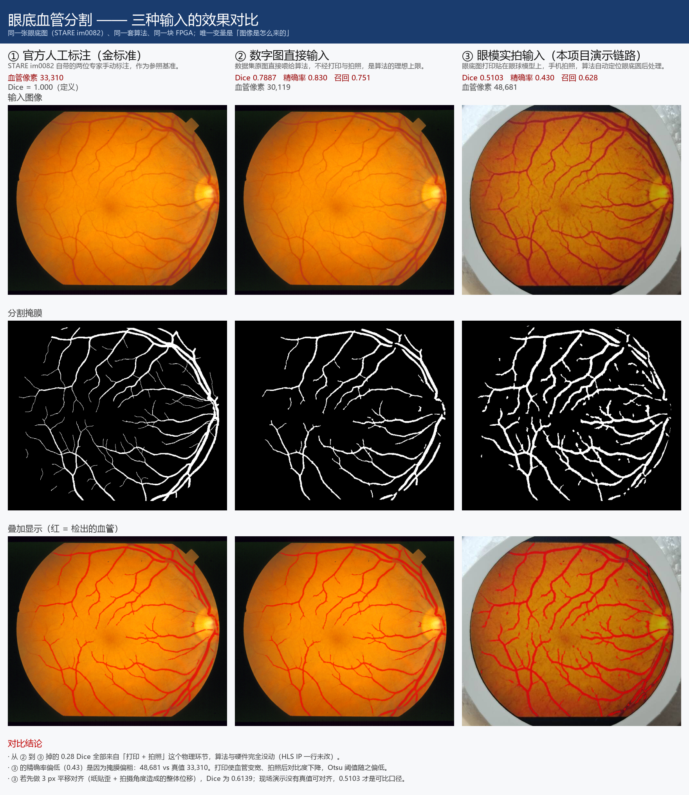

---

## 第四部分　总结

### 4.1 可扩展之处

本系统仍有明确的扩展空间。**其一，算子范围可扩展。** 当前仅中值与黑帽在 PL 端，若把 Otsu 改为"流式直方图统计 + 帧末阈值回代"，可在不增加整帧缓存的前提下再省一次全图扫描。**其二，尺寸可参数化。** 当前图像高宽以宏固化，改为运行时配置即可适配不同分辨率的眼底相机。**其三，帧级流水。** 当前一帧的 DMA 搬入与 IP 计算是串行的，若改为双缓冲乒乓帧，可把端到端延迟进一步压缩到接近核心耗时。面向更高分辨率时行缓存与 BRAM 是瓶颈[18]，现有流式架构与计算复用策略[19]是基础。**其四，算法可平滑升级。** 形态学算子替换为轻量卷积网络时，行缓冲结构可复用，仅需替换计算单元；同类工作表明，资源受限平台上通常需以简化算子换取实时性[20]。**其五，接口可扩展。** 接入 CSI 或 HDMI 输入后即可脱离手机，构成独立的实时采集终端。

### 4.2 心得体会

本次开发从零起步，Vivado、Vitis HLS、AXI 总线与时序约束都是第一次接触。回头看，支撑团队走完全程的不是某项技术，而是三件事：把流程拆细、把判据定严、把数字记准。

**把流程拆细。** 项目被拆成十二个阶段，每阶段都有明确的通过判据，前一阶段未通过不进入下一阶段。这个约定前期看起来很慢——光软件原型就迭代三版才定下算法，但它避免了最危险的情形：在错误的基础上一路做到最后。

**先测量，再优化。** 最初我们凭直觉认为瓶颈在阈值与连通域，准备把它们搬进硬件。真正对流水线逐段计时后才发现，3×3 中值与 11×11 黑帽两个算子占了绝大部分时间，而 11×11 形态学每像素要做 121 次比较——这次测量直接改变了软硬件切分方案。同样地，端到端加速比一度只有 1.12 倍，我们没有急着改代码，而是先逐段计时，结果发现视野掩膜生成里跑了 50 次闭运算，而这个操作是幂等的，等价只需 1 次。删掉后加速比升到 1.66 倍，输出逐像素不变。

**硬件思维与软件思维是两回事。** 软件里遍历像素的双重循环天经地义，硬件里同样的写法却导致综合失败或吞吐极低。最初的整帧缓存版本中值滤波 II 只能到 9，膨胀与腐蚀甚至无法完成综合；改成流式行缓冲后才降到 II = 1。更关键的体会是：吞吐要以仿真和板上实测为准，工具的静态估计可能偏乐观一倍。最终板上 4.476 ms 与协同仿真 4.427 ms 只差 1.1%，这个一致性本身就是对设计方法的检验。

**"跑得动"不等于"跑得对"。** 这是代价最大的教训。有一次压测中系统连续跑数百帧，耗时分毫不差、也无异常，但 85% 的像素是错的——原因是一次被中止的 DMA 传输污染了 IP 内部状态，而重载位流是唯一的清除手段。此后压测判据改成"逐帧与软件真值逐像素比对"，而不是"没有报错"。另外板端计时必须先预热再取中位数：某些算子首次调用有一次性的大开销，不预热会让含视野生成的加速比从 1.71 倍掉到 1.05 倍。

**数字要分口径报。** 加速比极易被误读。核心算子在吞吐口径下是 37.6 倍，在含 ARM 侧内存操作的延迟口径下是 17.4 倍，端到端又只有 2.24 倍。三个数字都对，差别在于计时边界。我们坚持分开报告并注明条件，因为没有口径的加速比没有意义。

**真实场景会提出数据集之外的问题。** 在标准数据集上一切正常，换成手机拍摄的照片后，Otsu 自动视野掩膜直接失效，Dice 掉到 0。这个问题在实验室里永远不会出现，却决定系统能否真被使用。解决办法是用算法适配现实——以 R−B 色度分割定位眼底区域，再按定位圆生成视野掩膜，硬件 IP 一行未改；至于无法用算法弥补的几何条件（镜头须正对眼底），则以明确的拍摄要求交付给使用者，而不是含糊地宣称怎么拍都能用。这两件事的区分本身就是一次校准：把能做的做到，把做不到的说清。

**不足与展望。** 实拍链路的精度受几何配准限制，与真值有 2~3 像素系统偏差，相关数字应作几何上限理解；实时血管提取目前只是工程可行性论证，尚未临床验证。两点如实写明，不做夸大。

这次开发让我们真正理解了"软硬件协同"的含义：它不是把软件代码翻译成硬件，而是先弄清楚每一段计算究竟适合在哪里做。

---

## 第五部分　参考文献

[1] OTSU N. A threshold selection method from gray-level histograms[J]. IEEE Transactions on Systems, Man, and Cybernetics, 1979, 9(1): 62-66.

[2] ZUIDERVELD K. Contrast limited adaptive histogram equalization[M]//HECKBERT P S. Graphics Gems IV. San Diego: Academic Press, 1994: 474-485.

[3] SOILLE P. Morphological image analysis: principles and applications[M]. 2nd ed. Berlin: Springer, 2004.

[4] GONZALEZ R C, WOODS R E. Digital image processing[M]. 4th ed. New York: Pearson, 2018.

[5] HUANG T S, YANG G J, TANG G Y. A fast two-dimensional median filtering algorithm[J]. IEEE Transactions on Acoustics, Speech, and Signal Processing, 1979, 27(1): 13-18.

[6] AMD XILINX. Zynq-7000 SoC technical reference manual: UG585 (v1.12.2)[Z]. San Jose: AMD Xilinx, 2018.

[7] AMD XILINX. AXI DMA LogiCORE IP product guide: PG021 (v7.1)[Z]. San Jose: AMD Xilinx, 2022.

[8] AMD XILINX. Vitis high-level synthesis user guide: UG1399 (v2022.2)[Z]. San Jose: AMD Xilinx, 2022.

[9] FRAZ M M, REMAGNINO P, HOPPE A, et al. Blood vessel segmentation methodologies in retinal images: a survey[J]. Computer Methods and Programs in Biomedicine, 2012, 108(1): 407-433.

[10] CHAUDHURI S, CHATTERJEE S, KATZ N, et al. Detection of blood vessels in retinal images using two-dimensional matched filters[J]. IEEE Transactions on Medical Imaging, 1989, 8(3): 263-269.

[11] RICCI E, PERFETTI R. Retinal blood vessel segmentation using line operators and support vector classification[J]. IEEE Transactions on Medical Imaging, 2007, 26(10): 1357-1365.

[12] NGUYEN U T V, BHUIYAN A, PARK L A F, et al. An effective retinal blood vessel segmentation method using multi-scale line detection[J]. Pattern Recognition, 2013, 46(3): 703-715.

[13] MARIN D, AQUINO A, GEGUNDEZ-ARIAS M E, et al. A new supervised method for blood vessel segmentation in retinal images by using gray-level and moment invariants-based features[J]. IEEE Transactions on Medical Imaging, 2011, 30(1): 146-158.

[14] RONNEBERGER O, FISCHER P, BROX T. U-Net: convolutional networks for biomedical image segmentation[C]//Medical Image Computing and Computer-Assisted Intervention (MICCAI 2015). Cham: Springer, 2015: 234-241.

[15] HOOVER A, KOUZNETSOVA V, GOLDBAUM M. Locating blood vessels in retinal images by piecewise threshold probing of a matched filter response[J]. IEEE Transactions on Medical Imaging, 2000, 19(3): 203-210.

[16] STAAL J, ABRAMOFF M D, NIEMEIJER M, et al. Ridge-based vessel segmentation in color images of the retina[J]. IEEE Transactions on Medical Imaging, 2004, 23(4): 501-509.

[17] KOUKOUNIS D, TTOFIS C, PAPADOPOULOS A, et al. A high performance hardware architecture for portable, low-power retinal vessel segmentation[J]. Integration, the VLSI Journal, 2014, 47(3): 377-386.

[18] BENDAOUDI H, CHERIET F, MANRAJ A, et al. Flexible architectures for retinal blood vessel segmentation in high-resolution fundus images[J]. Journal of Real-Time Image Processing, 2018, 15(1): 31-42.

[19] BENDAOUDI H, CHERIET F, LANGLOIS J M P. Memory efficient multi-scale line detector architecture for retinal blood vessel segmentation[C]//2016 Conference on Design and Architectures for Signal and Image Processing (DASIP). Piscataway: IEEE, 2016: 59-64.

[20] SIVAKAMASUNDARI J, KAVITHA G, SUJATHA C M, et al. FPGA based hardware synthesis for automatic segmentation of retinal blood vessels in diabetic retinopathy images[J]. Biomedical Sciences Instrumentation, 2014, 50: 156-163.
